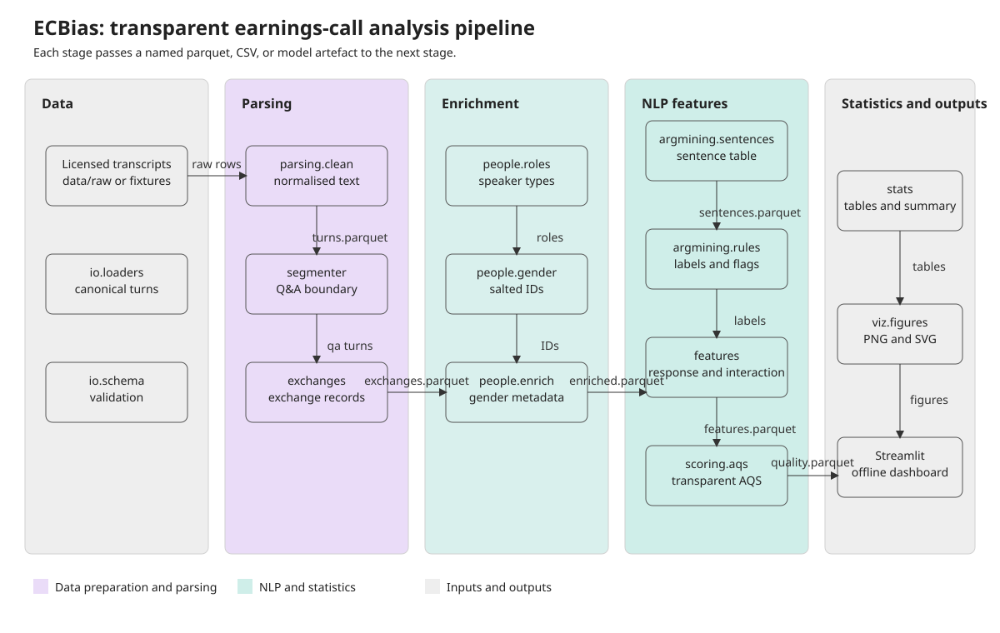
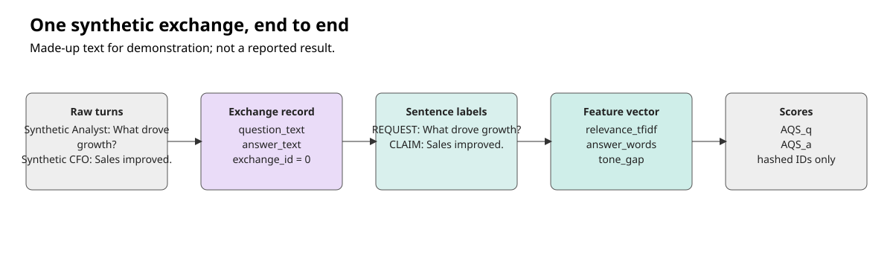
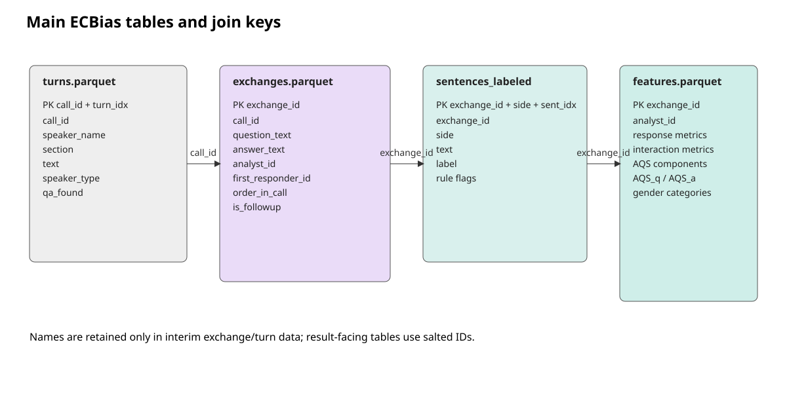

# Architecture

ECBias analyses one exchange at a time: an analyst question and the executive answers that
follow. The generated fixture pipeline contains 38 turns, 12 exchanges, 25 sentence rows, and
12 merged feature rows. The Q&A marker was found for 11 of 12 calls.

## Pipeline

| Stage | Inputs | Outputs | Main files/modules |
|---|---|---|---|
| Data preparation | Licensed transcript files or `tests/fixtures/` | Canonical turns | `src/ecbias/io/loaders.py`, `src/ecbias/io/schema.py`, `data/interim/turns.parquet` |
| Parsing | Canonical turns and configured Q&A markers | Q&A turns and exchanges | `src/ecbias/parsing/clean.py`, `segmenter.py`, `exchanges.py`, `data/interim/exchanges.parquet` |
| Enrichment | Turns, exchanges, title lexicon, gender overrides | Roles, salted IDs, inferred perceived gender | `src/ecbias/people/`, `data/interim/exchanges_enriched.parquet` |
| NLP features | Enriched exchanges and sentence rows | Argument labels, AQS, response and interaction measures | `src/ecbias/argmining/`, `src/ecbias/features/`, `src/ecbias/scoring/` |
| Statistics and outputs | Processed features and configured hypotheses | Tables, figures, summary, manifest | `src/ecbias/stats/`, `src/ecbias/viz/`, `results/` |

`ecbias run-all` executes the stages in order, prints timings, and writes
`results/run_manifest.json` with versions, hashes, row counts, seed, and commit.

## Design decisions

- **Exchange as the unit:** it preserves the question-to-answer interaction instead of treating
  isolated sentences as independent conversations.
- **Config-driven ingestion:** column mappings and parsing markers are data-set configuration,
  so a new transcript format should not require parser rewrites.
- **Classical NLP:** spaCy segmentation/NER, TF-IDF, lexicons, and scikit-learn models are
  inspectable and run offline on a laptop. This matches the coursework constraint and makes
  feature contributions auditable.
- **Privacy by construction:** result tables use salted identifiers rather than speaker names.
- **Transparent scoring:** AQS is a weighted rubric with documented components and sensitivity
  scorers, not a black box or ground truth.

## Rejected alternatives

- **Transformers or hosted LLMs:** rejected because they add GPU/API cost, reduce auditability,
  and violate the no-LLM constraint.
- **Opaque end-to-end quality prediction:** rejected because the project requires an explainable
  rubric and explicit validity limitations.
- **Speaker-level public reporting:** rejected because individual-level gender claims would be
  invasive and unreliable.
